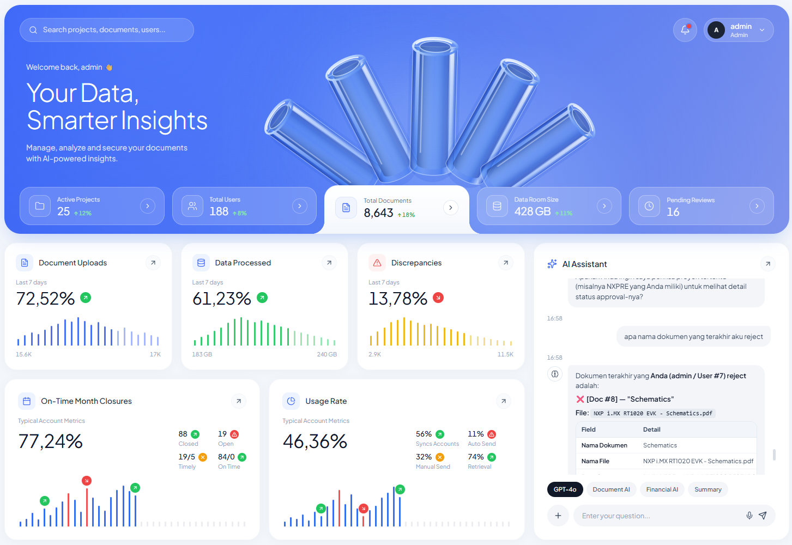
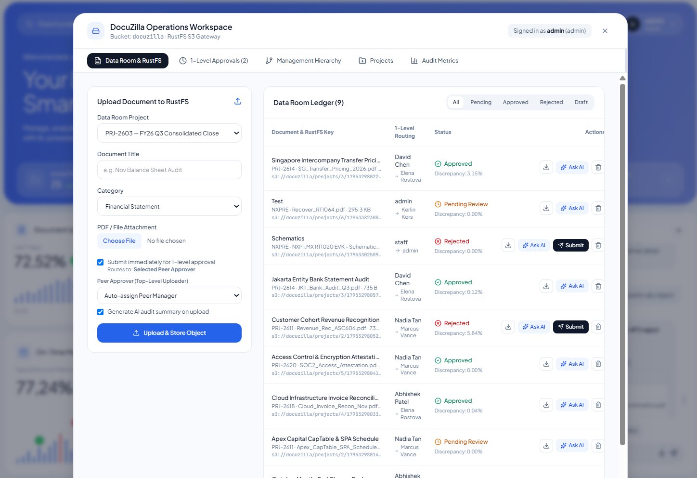
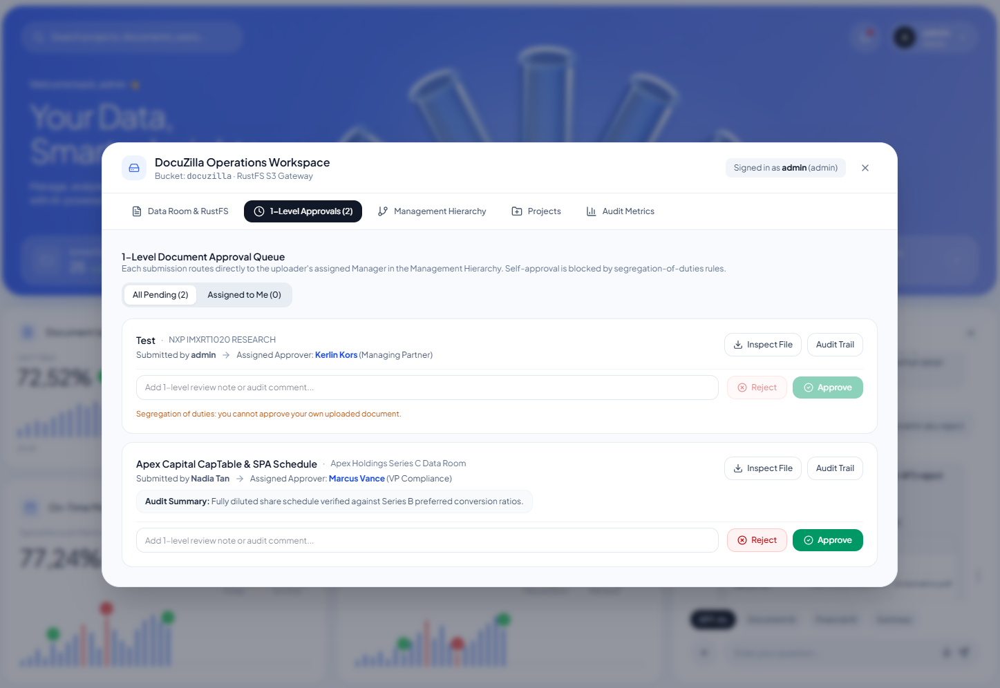
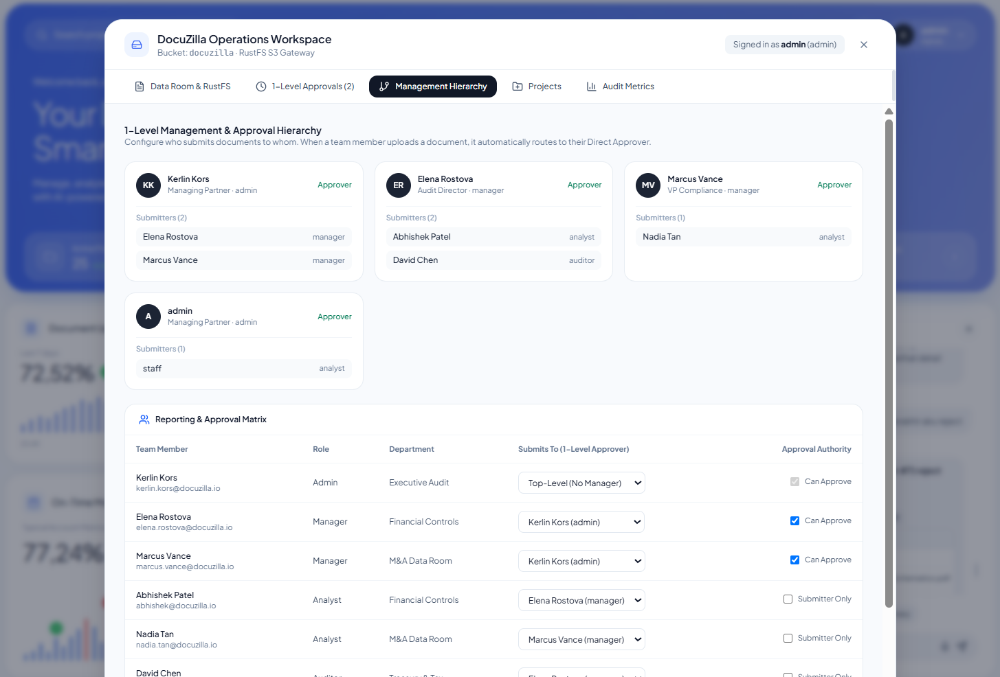
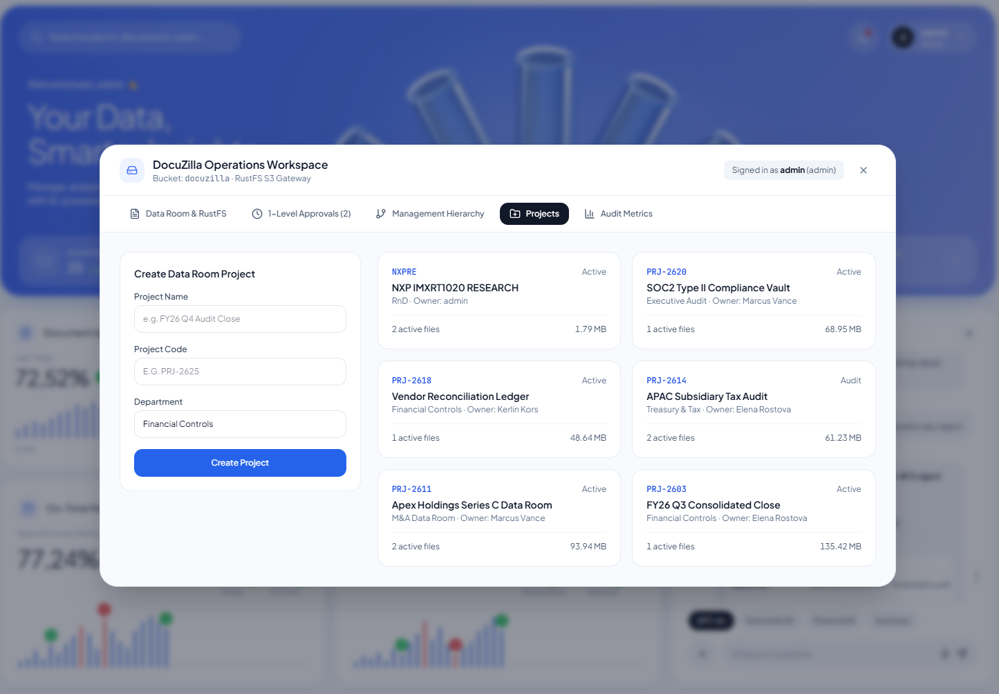
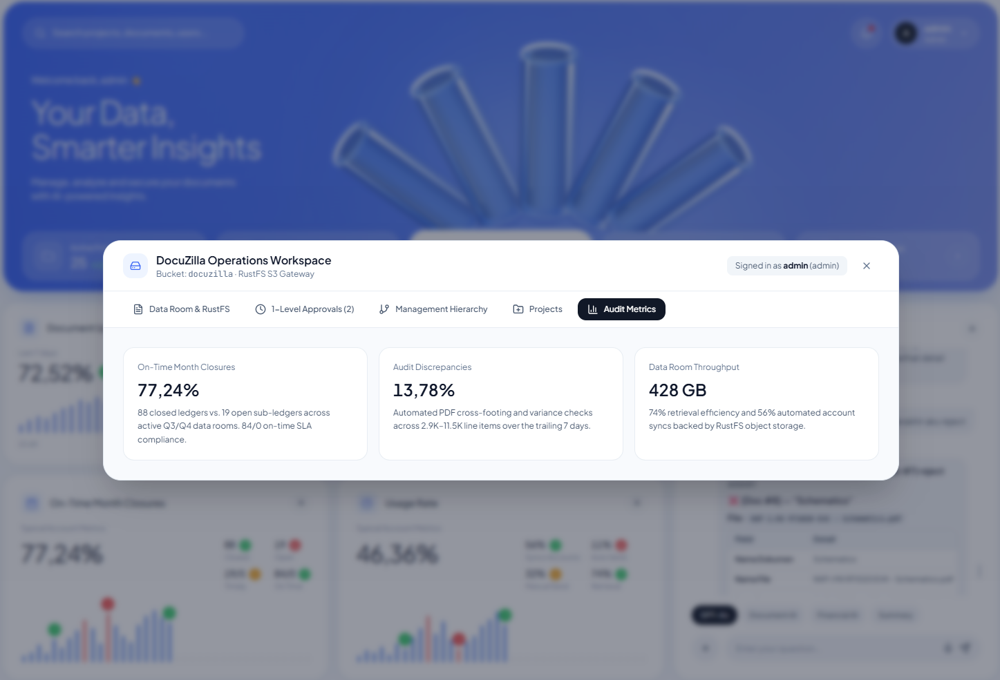

<div align="center">

# DocuZilla

**Enterprise Data Room, 1-Level Audit Approval Workflow & RustFS RAG AI Intelligence**

[](https://react.dev/)
[](https://www.typescriptlang.org/)
[](https://tailwindcss.com/)
[](https://expressjs.com/)
[](https://orm.drizzle.team/)
[](https://rustfs.com/)
[](#apps-system-architecture)

Manage, analyze, and govern financial & technical data rooms with real-time audit KPIs, strict 1-level management approval routing, S3-backed RustFS storage, and live workspace + PDF RAG intelligence.

</div>

---

## Product Showcase

<p align="center">
  
</p>

<table>
  <tr>
    <td width="33.3%" align="center" valign="top">
      
      <br />
      <strong>Data Room &amp; RustFS Ledger</strong>
      <br />
      <sub>Upload, inspect, download, and manage versioned files directly in RustFS S3 buckets.</sub>
    </td>
    <td width="33.3%" align="center" valign="top">
      
      <br />
      <strong>1-Level Approval Queue</strong>
      <br />
      <sub>Segregation-of-duties review routing with full audit trail &amp; manager sign-off.</sub>
    </td>
    <td width="33.3%" align="center" valign="top">
      
      <br />
      <strong>Management Hierarchy</strong>
      <br />
      <sub>Visual reporting tree &amp; matrix configuring who submits to whom.</sub>
    </td>
  </tr>
  <tr>
    <td width="33.3%" align="center" valign="top">
      
      <br />
      <strong>Data Room Projects</strong>
      <br />
      <sub>Department-scoped project vaults with ownership, status, and storage tracking.</sub>
    </td>
    <td width="33.3%" align="center" valign="top">
      
      <br />
      <strong>Audit Metrics</strong>
      <br />
      <sub>On-time month closures, audit discrepancy rates, and RustFS data room throughput.</sub>
    </td>
    <td width="33.3%" align="center" valign="middle">
      <strong>Core Capabilities</strong>
      <br /><br />
      <sub>
        &bull; Live RustFS PDF RAG &amp; Workspace Q&amp;A<br />
        &bull; Pure-React GFM Markdown &amp; Table Chat<br />
        &bull; Split-Credential PostgreSQL + Drizzle<br />
        &bull; HMAC-SHA256 Token &amp; Scrypt Auth<br />
        &bull; WAF-Resilient S3 Object Transport
      </sub>
    </td>
  </tr>
</table>

---

## Project Structure

```text
docuzilla/
├── docs/                                # Product screenshots & documentation assets
│   ├── screen_docu_zilla_main.png
│   ├── screen_docu_zilla_dataroom.png
│   ├── screen_docu_zilla_approvals.png
│   ├── screen_docu_zilla_hierarchy.png
│   ├── screen_docu_zilla_projects.png
│   └── screen_docu_zilla_metrics.png
├── server/
│   ├── db_bridge.ts                     # Server entrypoint re-exporting Drizzle DB pool
│   └── services/
│       ├── aiAssistant.ts               # OpenAI-compatible client, unpdf parser & RustFS RAG
│       ├── auth.ts                      # Scrypt password hashing & HMAC-SHA256 bearer tokens
│       ├── repository.ts                # PostgreSQL + in-memory fallback data repository
│       └── rustfs.ts                    # AWS S3 SDK v3 client for RustFS object storage
├── src/
│   ├── components/
│   │   ├── AiAssistantCard.tsx          # Multi-mode AI chat widget with PDF/doc attachment
│   │   ├── AnalyticsSection.tsx         # 5-card audit analytics & micro-bar visualizations
│   │   ├── AuthModal.tsx                # First-run Admin Claim, Sign In & Team Registration
│   │   ├── HeroBanner.tsx               # Searchable header, KPI strip & pending review bell
│   │   ├── HeroGlassFan.tsx             # Translucent 3D glass-fan decorative backdrop
│   │   ├── MarkdownMessage.tsx          # Safe JSX GFM Markdown & horizontal-scroll table UI
│   │   └── WorkspaceModal.tsx           # 5-tab Operations modal (Ledger, Approvals, Org, Projects, Metrics)
│   ├── db/
│   │   ├── index.ts                     # pg.Pool split-credential connector & schema bootstrap
│   │   └── schema.ts                    # Drizzle PostgreSQL schema (users, projects, docs, events, AI, analytics)
│   ├── lib/
│   │   └── api.ts                       # Typed frontend API client (in-memory Bearer auth)
│   ├── types/
│   │   └── docuzilla.ts                 # Shared TypeScript interfaces
│   ├── App.tsx                          # Root dashboard layout & modal state orchestration
│   ├── index.css                        # Tailwind CSS v4 global theme & scrollbar styles
│   └── main.tsx                         # React 19 entry point
├── server.ts                            # Express API server + Vite dev/static production host
├── drizzle.config.ts                    # Drizzle Kit migration configuration
├── vite.config.ts                       # Vite + React + Tailwind v4 build config
├── tsconfig.json                        # Strict TypeScript configuration
├── .env.example                         # Environment variable template (no secrets)
└── package.json                         # Scripts & dependencies
```

---

## Apps System Architecture

```text
+-----------------------------------------------------------------------------------+
|                        Browser SPA (React 19 + Tailwind v4)                       |
|  HeroBanner  |  AnalyticsSection  |  AiAssistantCard (GFM)  |  WorkspaceModal     |
|                 In-Memory Bearer Token (never persisted to storage)               |
+-----------------------------------------+-----------------------------------------+
                                          | HTTPS /api/* (JSON & multipart/form-data)
                                          v
+-----------------------------------------------------------------------------------+
|                        Express API Server (server.ts / Node 22)                   |
|  - Auth & RBAC (auth.ts): Scrypt hashing, HMAC-SHA256 tokens, rate limiting       |
|  - 1-Level Approval Engine: Auto-routes uploads to uploader's direct manager      |
|  - Segregation of Duties: Blocks self-approval on pending documents               |
|  - Multer Memory Upload (25 MB limit, MIME allowlist)                             |
+-------------------+-----------------------------+---------------------------------+
                    |                             |
                    v                             v
+-----------------------------------+   +-------------------------------------------+
|  PostgreSQL + Drizzle ORM         |   |  RustFS S3 Object Store (rustfs.ts)       |
|  - Split Credentials (PGHOST...)  |   |  - AWS SDK v3 S3Client (forcePathStyle)   |
|  - Auto-creates tables on boot    |   |  - Preserves original MIME ContentType    |
|  - Users, Hierarchy, Projects     |   |  - Content-Encoding: gzip transport on    |
|  - Documents, Approval Events     |   |    WAF-blocked binary/XMP PDFs so console |
|  - AI Chat History & Snapshots    |   |    preview & download remain uncorrupted  |
+-------------------+---------------+   +---------------------+---------------------+
                    |                                         |
                    +--------------------+--------------------+
                                         |
                                         v
+-----------------------------------------------------------------------------------+
|               AI Assistant & RustFS RAG Engine (aiAssistant.ts)                   |
|  1. Loads live workspace context (User Identity, Projects, Hierarchy, Catalog)    |
|  2. Scores & fetches top-3 relevant objects from RustFS S3                        |
|  3. Extracts PDF text via unpdf with SHA-256 in-memory text cache                 |
|  4. Sends grounded prompt + chat history -> OpenAI-Compatible /v1/chat/completions|
+-----------------------------------------------------------------------------------+
```

### Key Architectural Guarantees
- **Split PostgreSQL Credentials**: Connects strictly via `PGHOST`, `PGPORT`, `PGDATABASE`, `PGUSER`, and `PGPASSWORD` (`src/db/index.ts`), with automatic table creation and idempotent seed recovery.
- **Unencrypted, Previewable RustFS Storage**: Objects are stored with their true `ContentType` (`application/pdf`, `text/csv`, etc.) and raw bytes—never custom-encrypted wrappers—using automatic `Content-Encoding: gzip` transport fallback if an upstream WAF blocks raw PDF metadata headers.
- **Zero-Trust Approval Routing**: Every submitted document routes to the uploader's configured manager (`managerId`), and server-side checks enforce segregation of duties so uploaders cannot approve their own files.

---

## Tech Stack

| Layer | Technology |
| :--- | :--- |
| **Frontend** | React 19, TypeScript, Tailwind CSS v4, Lucide Icons, Motion |
| **Backend** | Node.js 22 (native TypeScript execution), Express 4, Multer |
| **Database & ORM** | PostgreSQL (`pg`), Drizzle ORM (`drizzle-orm` / `drizzle-kit`) |
| **Object Storage** | RustFS (S3-compatible) via `@aws-sdk/client-s3` |
| **AI & Document RAG** | OpenAI-Compatible Chat Completions API (`/v1/chat/completions`), `unpdf` |
| **Build & Tooling** | Vite 8, `tsx`, TypeScript Compiler (`tsc --noEmit`) |

---

## How to Build

### 1. Prerequisites
- **Node.js `>= 22.18`** (required for native `node server.ts` TypeScript execution in production)
- **PostgreSQL** database instance
- **RustFS** (or S3-compatible) bucket & credentials
- **OpenAI-Compatible API** host & key (e.g., `https://ai.sumopod.com` or `https://api.openai.com/v1`)

### 2. Install Dependencies
```bash
npm install
```

### 3. Configure Environment
Copy `.env.example` to `.env` for local development (never commit `.env`):
```bash
cp .env.example .env
```

Fill in the required variables:
```env
# PostgreSQL (Split Credentials)
PGHOST=your-postgres-host
PGPORT=5432
PGDATABASE=postgres
PGUSER=your-postgres-user
PGPASSWORD=your-postgres-password
# Optional for local/internal Postgres without SSL:
# PGSSLMODE=disable

# RustFS S3 Storage
RUSTFS_ENDPOINT=https://s3.rustfs.com
RUSTFS_REGION=us-east-1
RUSTFS_ACCESS_KEY=your-access-key
RUSTFS_SECRET_KEY=your-secret-key
RUSTFS_BUCKET=docuzilla

# OpenAI-Compatible AI Assistant
OPENAI_BASE_URL=https://ai.sumopod.com
OPENAI_API_KEY=your-api-key
OPENAI_MODEL=gpt-4o

# Session Signing Secret (min 16 random characters in production)
SESSION_SECRET=replace-with-strong-random-secret
```

### 4. Push Schema, Typecheck & Build
```bash
# Optional: sync schema explicitly via Drizzle Kit (server also auto-ensures tables on boot)
npm run db:push

# Typecheck TypeScript across client & server
npm run lint

# Build production frontend bundle into dist/
npm run build
```

### 5. Run Locally in Development
```bash
npm run dev
```
The server listens on `http://localhost:3000`.

---

## How to Deploy

### Production Runtime (`Node.js` / `Docker` / `Cloud Run`)
DocuZilla runs as a single full-stack Node.js process (`server.ts`) serving both `/api/*` routes and the built static `dist/` SPA when `NODE_ENV=production`.

```bash
npm ci
npm run build
NODE_ENV=production PORT=3000 npm start
```

### Production Checklist
1. **Environment Secrets**: Inject `PGHOST`, `PGPORT`, `PGDATABASE`, `PGUSER`, `PGPASSWORD`, `RUSTFS_ENDPOINT`, `RUSTFS_REGION`, `RUSTFS_ACCESS_KEY`, `RUSTFS_SECRET_KEY`, `RUSTFS_BUCKET`, `OPENAI_BASE_URL`, `OPENAI_API_KEY`, `OPENAI_MODEL`, and `SESSION_SECRET` (at least 16 random characters) as platform secrets.
2. **PostgreSQL SSL**: Cloud PostgreSQL instances work out of the box with TLS. If deploying alongside an internal VPC/Docker PostgreSQL without TLS, set `PGSSLMODE=disable`.
3. **Health & Storage Readiness Check**:
   - Liveness: `GET /api/health` -> returns `{"status":"ok","database":"postgresql-drizzle","storage":"rustfs-s3","aiConfigured":true}`
   - Deep Storage Probe: `GET /api/health?probe=storage` -> performs read-only `HeadBucket` and `ListObjectsV2` checks against RustFS.
4. **First-Run Admin Account**: Open the app, click **Sign In**, and complete the one-time **Admin Setup** (automatically locks once an admin password exists).
